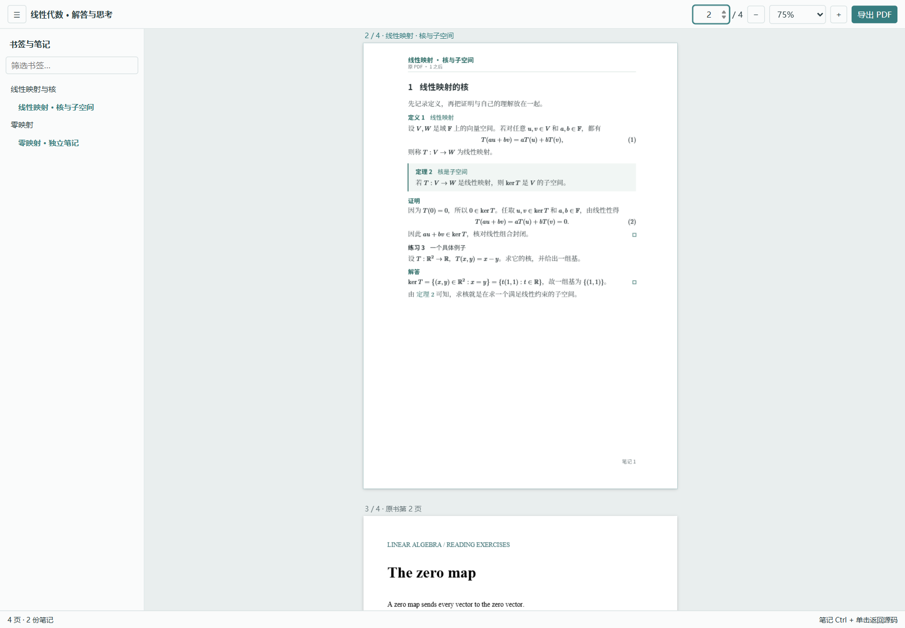

# Typst PDF Notebook

VS Code 插件：Typst 排版笔记，插件负责整本 PDF 阅读、虚拟插页和最终导出。运行和构建均不需要 Python。

Read a PDF alongside native Typst notes. Keep the original text selectable, jump between note source and preview, and export one PDF with notes inserted after the relevant pages.



## 使用

要求 VS Code 1.143.1 或更新版本。Windows、macOS、Linux 均有安装与运行测试。

1. 在扩展市场搜索 **Typst PDF Notebook**（发布者 **ArcBC**），或从 [GitHub Actions](https://github.com/ArchiBC/typst-pdf-notebook/actions) 下载 VSIX 后执行 **Extensions: Install from VSIX**。VS Code 会自动安装依赖 Tinymist（要求 0.15.10 或更新版本）。
2. 在 VS Code 资源管理器中，右键 PDF → **新建 Typst 笔记**。右键文件夹也有此入口：其中只有一本 PDF 时直接使用，否则弹出选择框。
3. 插件只在 PDF 旁边创建 `原书名.notes.typ`，自动填写原书路径和第一页尺寸。不生成 `template.typ` 或 `.vscode/settings.json`。同名笔记已存在时打开原文件，保留未保存的编辑。`.notes` 后缀也让普通 Typst 导出得到独立的笔记 PDF 文件名。
4. 执行 **PDF Notebook: 打开整本笔记预览**，或点击 Typst 编辑器右上角的书本按钮。

若之前安装过发布者为 `archi` 的本地开发版，请先卸载旧版扩展，再安装 `ArcBC` 版，避免两份扩展注册同名命令。笔记文件和本地 Typst 模板包可继续使用。

```typst
#import "@local/typst-pdf-notebook:0.3.3": *
#show: notebook.with(pdf: "book.pdf")

#note("习题1A")
#include "notes/answers-1a.typ"

#note(28)

= 我的理解

在原 PDF 第 28 页之后插入笔记。这里直接顶格写正文。

$a + b = b + a$
```

`#note(...)` 后的内容一直归属于该笔记，直到下一处标记或文件结尾。也支持 `#note(28)[正文]`。笔记页数随内容增减，空笔记不插页。独立笔记文件可以只写正文；其内部使用自定义函数时，需要按 Typst 作用域规则自行导入。

`#note(28)` 使用原 PDF 的物理页码，含封面。书签可用完整标题或 `pdf-001` 这样的唯一 ID；重复标题需要使用 ID。插件直接读取原 PDF 的书签，不需要事先导出 JSON。

默认排版基于 [Chengsi（澄思）0.1.2](https://typst.app/universe/package/chengsi/)。正文、公式、定理、证明等样式来自内置的 Chengsi；封面、目录和章强制换页在插页模式中固定关闭。标题使用紧凑的节标题样式，并保持原生编号和交叉引用。纸张仍使用原 PDF 的尺寸。

模板实现已随插件内置，不需要在书籍文件夹复制整份 `.typ`。插件在激活时将它安装为标准 Typst 本地包；导入固定版本后，Tinymist 和 Typst CLI 都能直接识别。Windows 的默认安装位置是 `%APPDATA%/typst/packages/local/typst-pdf-notebook/0.3.3`；也支持 `TYPST_PACKAGE_PATH` 环境变量。Chengsi 的源码、三套配色和代码高亮资源均随插件分发，默认编译不需要下载外部包。参考 [Typst 本地包说明](https://github.com/typst/packages#local-packages)。插件不会覆盖本地包中已有的不同内容。

旧版笔记打开时，编辑器右上角会出现 **升级笔记模板**（向上箭头）按钮。点击后更新到当前插件内置的模板版本；升级完成后按钮隐藏，也支持撤销和重做。按钮随当前编辑器和未保存的 import 变化刷新，不自动改写或保存文件；较新版本的模板不会被降级。

如果打开整本预览时编译失败，预览会显示错误详情，修正源码后自动恢复。旧版模板还会显示 **升级模板并重试**：例如 `0.3.2` 笔记使用 `#note(15, right)` 时，需要升级到 `0.3.3`。这个入口修改该预览对应笔记的导入，保留正文及未保存修改，支持撤销，不自动保存文件。

旧版 `0.2.0`、`0.3.0`、`0.3.1` 和 `0.3.2` 模板也随插件提供，已有笔记可继续编译。需要采用最新默认行为时，右键笔记入口（或旧模板配置文件）→ **升级笔记模板**，也可从命令面板执行 **PDF Notebook: 升级笔记模板**，把旧版本导入更新到 `0.3.3`。这个命令通过编辑器修改 import，保留正文和未保存的修改；标准的 `note, notebook` 导入会变成 `*`，自定义导入和别名保持原样，是否保存由你决定。

## 页内右侧便签

使用 `#sidenote(页码或书签)`，也可写成 `#note(页码或书签, right)`，把该笔记放到指定原页右侧。预览显示一张加宽页面，导出时用它替换原页，总页数不增加；原书文字可复制，笔记支持源码双向定位。便签默认宽度为主页的三分之一，没有页头、页脚和页码，后面直接顶格写正文：

```typst
#sidenote(15)

= 我的理解

在原书第 15 页右边直接记笔记。

#note("习题1A", right)
#include "notes/answers-1a.typ"

#sidenote(28, width: 50%)

这一页使用主页一半宽度的便签。

#note(30)

这份笔记仍是原书第 30 页后的普通附页。
```

`width: 50%` 表示 `notebook.with(size: ...)` 主页宽度的一半；也支持 `width: 1/2`、`width: 60mm`，或在 `notebook.with(side-width: 50%)` 中统一设置。便签高度沿用主页高度，内部页边距默认为 `6mm`，可用 `side-margin` 统一设置或单份便签的 `margin` 覆盖。原页保持原始大小，不缩放。旧的 `placement: "right"` 写法继续兼容；`right` 使用 Typst 自带的对齐值，不影响 `#align(right)`。

插件按实际分页检查便签。超过一页时，整份笔记自动按主页宽度重新排成普通附页，恢复普通附页的页头等样式；缩短后又恢复到右侧。脚注、定理引用和被 `include` 的正文也参与原生分页，不会先缩小字体。为了让一页只有一个右侧区域，同一原页的便签内容应写在同一处标记中；若同一页有多份右侧便签，或该原页高度小于笔记纸张高度，也会改为普通附页。普通附页和便签可以混用。分页检查通过同一 Tinymist 进程的输入参数完成，不生成额外文件；直接使用 Typst CLI 编译会得到笔记本身，自动回退和整本组合由插件处理。

现有笔记需要把内置模板导入更新到 `@local/typst-pdf-notebook:0.3.3` 才能使用简写和新的默认便签宽度。旧版本模板随插件保留，更新不会覆盖已有的模板包或自动改写笔记源码。完整示例见 `examples/side.notes.typ`。

## 数学笔记与配置

新建文件的 `*` 导入可以直接使用 `definition`、`theorem`、`lemma`、`proposition`、`corollary`、`example`、`exercise`、`proof`、`remark`、`epigraph` 和 `code`。普通笔记仍可在 `#note(...)` 后直接写正文，数学环境按需使用：

```typst
#note(28)

= 核与子空间

这里直接写自己的理解。

#theorem(title: [核是子空间])[
  若 $T: V -> W$ 是线性映射，则 $ker T$ 是 $V$ 的子空间。
] <kernel>

#proof[
  由线性性，核包含零向量，并且对线性组合封闭。
]

由 @kernel 可知，求核就是求一个满足线性约束的子空间。
```

每个 `#note(...)` 是独立的编号单元：标题及其子标题、行间公式、定理、例题、图、表和脚注在新笔记中重新从 1 开始；同一笔记跨页时继续编号。定理、定义、引理、命题、推论和练习在该笔记内共用一个编号序列，例题单独编号。空笔记不会产生额外单元。整本预览的物理页码和插页位置不受影响。

原生标签和 `@引用` 可用，包括跨笔记引用；标签名称仍须在整个文档中唯一。长定理、长证明会自然跨页。完整示例见 `examples/chengsi.notes.typ`。不需要标题编号时，在下方配置中设置 `heading-numbering: none`，公式和定理仍按各自的设置编号。

Chengsi 配置放在同一个笔记文件的 `notebook.with(config: (...))` 中，不需要新建配置文件：

```typst
#show: notebook.with(
  pdf: "book.pdf",
  size: (176mm, 250mm),
  config: (
    theme: "indigo", // teal / indigo / sepia
    font-size: 11pt,
    margin: 15mm,
    heading-numbering: none,
    equation-numbering: "(1)",
    theorem-numbering: "1",
  ),
)
```

其余 [Chengsi 配置项](https://typst.app/universe/package/chengsi/)也可使用，例如 `font-cjk`、`font-heading`、`font-math`、`leading`、`paragraph-spacing`、`headers` 和 `page-numbers`。页尺寸由 `size` 控制；`cover`、`toc`、`chapter-break` 始终为 `false`。默认中文字体为 Noto Serif SC / Noto Sans SC，公式字体为 New Computer Modern Math。可通过配置改成系统已有字体。

`notebook.with(...)` 的 `note-settings` 可按位置设置标题、样式和 ID；每次 `#note(...)` 的显式选项优先。纸张样式支持 `blank`、`ruled`、`grid`。纸张尺寸、自定义书签等也通过参数传入：

```typst
#show: notebook.with(
  pdf: "book.pdf",
  title: "阅读笔记",
  size: (176mm, 250mm),
  bookmarks: (
    (page: 28, title: "重做这页", id: "redo", depth: 0),
  ),
  note-settings: (
    "28": (title: "定义与例子", style: "grid"),
  ),
)
```

之后可使用 `#note("redo")`。笔记中导入 `source-ref` 后，可写 `#source-ref(28)[返回原题]`；预览和导出的链接都指向原书页。

默认的配置入口是笔记开头的 `notebook.with(...)`，可直接修改；预览是否跟随光标等插件行为在 VS Code 设置中调整。若多本书需要共享配置，再自行抽成一个短文件，例如 `template.typ`，插件不会自动生成它：

```typst
// template.typ：只写配置，模板实现在插件内。
#import "@local/typst-pdf-notebook:0.3.3" as core
#let note = core.note
#let source-ref = core.source-ref
#let notebook = core.notebook.with(pdf: "book.pdf", size: (176mm, 250mm))
```

`main.typ` 仍用 `#import "template.typ": notebook, note` 和 `#show: notebook`。旧版自带完整实现的本地模板也可继续使用。包版本固定在 import 中，更新插件不会自动改写笔记源码。

## 定位、预览与导出

- 原书文字可拖选、复制；书签和原书内部页链接支持跳转。
- 移动笔记源码光标会定位相应预览段落，也可按 **Ctrl+Alt+J** 主动定位。
- 在笔记正文上 **Ctrl+单击**，返回对应源码文件和位置。原书文字不触发源码跳转。
- 输入时自动更新未保存的笔记；编译失败时保留最后一次成功的页面，修复源码后自动恢复。
- 原书 PDF 常驻一个文档对象，绘制附近页面，并限制页面画布缓存。编辑笔记只替换笔记文档和页码映射。
- 滚动使用页面位置索引，只处理附近的页面。画布缓存预算为 96 MiB，优先保留可见页；单画布限制为 16M 像素。移出缓存时释放像素和 PDF.js 页资源。
- 连续缩放先缩放已有内容，停止操作 160 ms 后重画。编辑笔记保留原书页面节点，避免重挂整本书。
- 点击 **导出 PDF**，或执行 **PDF Notebook: 导出插页 PDF**，才合成完整文件。书签、原书页内容流及内链在导出时重建或重映射。

笔记排版采用已安装 Tinymist 的原生引擎。插件启动自己的轻量 LSP 会话，只编译笔记，并复用 Tinymist 定位协议；VS Code 中原有 Tinymist 仍负责编辑器语言功能。源代码中的 include 和正常 Typst 排版均可用。

引擎跟随 `tinymist.serverPath`，未配置时依次使用 Tinymist 扩展内置程序和 PATH；同时继承 `tinymist.fontPaths` 及 `typstExtraArgs` 中的字体、输入变量、包目录等排版选项。笔记会话使用自身的入口和完整页输出，避免被编辑器固定的主文件或导出页范围改变。修改这些设置会重建笔记编译会话，保留当前未保存正文和最后一次成功预览。

相对字体和包路径按 Tinymist 编辑器服务的工作目录解析，即第一个工作区文件夹。Tinymist 0.15.10 的 `restartServer` 命令仍保留启动时的 `typstExtraArgs`；修改该设置后，整本预览会自动更新，编辑器语言服务需要重新加载 VS Code 窗口才能采用新参数。

内置模板先安装到 Tinymist 实际使用的本地包目录，再启动笔记编译。首次安装产生新文件时，插件会重启编辑器中的 Tinymist，刷新其缺失包缓存；模板没有变化时不会重复重启。该流程不生成笔记目录中的配置文件，也不修改用户的 Tinymist 设置。当前要求 Tinymist 0.15.10 或更新版本，并在初始化时检查导出和定位接口。

打开整本预览时，插件自动识别当前笔记；编辑 include 的正文时，复用最近使用的笔记入口。无需配置 `pdfNotebook.entry`。下面的工作区设置是可选的，其中 `entry` 仅作为备用入口：

```json
{
  "pdfNotebook.entry": "main.typ",
  "pdfNotebook.followCursor": true,
  "tinymist.exportPdf": "never",
  "tinymist.typstExtraArgs": ["main.typ"],
  "tinymist.rootPath": "${workspaceFolder}"
}
```

原书和入口需位于当前受信任工作区。导出支持常见 PDF 文字、矢量、页内批注、书签和跳转；文档级表单字段树、附件、签名等结构不属于本版迁移范围。原书页内的链接坐标不改动。已验证的定位协议版本为 Tinymist 0.15.10。

## 开发

Node.js 22.13+，本机需安装 Tinymist。插件代码集中在此项目，书籍和个人笔记保存在各自工作区。

```powershell
npm ci
npm run package
npm run test:prepare
npm test
npm run test:host
code --install-extension .\output\typst-pdf-notebook-0.3.7.vsix --force
```

按 F5 可启动扩展开发宿主。`test:prepare` 下载指定版本的 VS Code，在空扩展目录安装本项目 VSIX，验证 Tinymist 自动依赖安装，并准备固定版本的测试字体。`NOTEBOOK_VSCODE_VERSION` 可指定 VS Code 版本；本地可用 `NOTEBOOK_CODE_BIN` 指定已有程序，或用 `NOTEBOOK_FONT_PATHS`（JSON 路径数组）使用本机字体。

`test/run-host.cjs` 自动生成 341 页测试 PDF 和笔记工作区，覆盖仅有 PDF 时的命令激活、同目录单文件笔记、未保存编辑、分页、双向定位和错误恢复。还会给真实编辑器 Tinymist 使用一个空包目录，验证缺失包缓存的恢复及未保存正文保留。证据写到 `output/extension-host-evidence.json`，测试不依赖个人书籍或全局扩展目录。

另起一个干净宿主，验证启动时相对包目录、输入参数在编辑器 Tinymist 和笔记编译器中一致，结果写到 `output/tinymist-host-evidence.json`。

GitHub Actions 在每次 push / pull request 时打包一次，由 Windows、macOS、Linux 三个平台安装同一个 VSIX，并运行原生排版测试和真实 VS Code 宿主测试；Linux 宿主使用 Xvfb。失败日志和测试证据会保存为工作流附件。工作流仅构建和验证。

## 自动发版

`.github/workflows/release.yml` 在推送 `vX.Y.Z` 标签后自动运行：校对标签和清单版本、复用三平台 CI、校验安装包身份和 SHA-256，然后将同一份 VSIX 和校验文件发布为 GitHub Release。标签必须指向 `main` 历史中的提交，版本必须同时匹配 `package.json` 和 `package-lock.json`。历史版本不会覆盖较新版本的 Latest 标记，已有不同内容的附件不会被覆盖。

Marketplace 使用 GitHub OIDC 可信发布，不使用 Azure、PAT 或仓库发布密钥。市场自动上传默认关闭：仓库变量 `MARKETPLACE_TRUSTED_PUBLISHING=false` 时，标签仍会发布 GitHub 安装包，Release 说明会明确标注市场自动上传未启用。设为 `true` 后，市场发布必须成功，才会公开对应的 GitHub Release；OIDC 失败不会切换到其他凭据。

启用市场自动上传前，需要发布者 Owner 在 [Marketplace 后台](https://marketplace.visualstudio.com/manage/publishers/ArcBC) 的 **Trusted Publishing** 页面创建策略：

| 字段             | 值                           |
| ---------------- | ---------------------------- |
| Policy name      | `typst-pdf-notebook-release` |
| Repository owner | `ArchiBC`                    |
| Repository       | `typst-pdf-notebook`         |
| Workflow         | `release.yml`                |
| Environment      | `marketplace`                |

Marketplace 已于 2026-10-28 [正式开放 GitHub Trusted Publishing](https://developer.microsoft.com/blog/trusted-publishing-visual-studio-marketplace/)，配置步骤见 [官方发布文档](https://code.visualstudio.com/api/working-with-extensions/publishing-extension#publish-with-github-actions-and-trusted-publishing)。发布工具固定为稳定版 `@vscode/vsce@4.1.0`。

GitHub 的 `marketplace` 环境只允许 `v*` 标签部署。确认后台已创建上述策略后，在 [Actions 变量设置](https://github.com/ArchiBC/typst-pdf-notebook/settings/variables/actions) 将 `MARKETPLACE_TRUSTED_PUBLISHING` 改为 `true`；策略未建好前保持 `false`。下一次正常版本标签发布时验证 OIDC 交换及上传结果。手动 dry run 只验证打包与三平台 CI，不会交换发布凭据或上传市场；不需要为测试创建版本标签。

日常发版示例（先在 CHANGELOG 中补齐新版本说明）：

```powershell
npm version patch --no-git-tag-version
git add package.json package-lock.json CHANGELOG.md
git commit -m "Release 0.3.4"
git tag v0.3.4
git push origin main
git push origin v0.3.4
```

安装包文件名自动读取版本，无需同步修改打包命令。不要移动已发布的标签，也不要使用已发布过的版本号重新发包。中途失败时优先在 Actions 中 **Re-run failed jobs**，复用已经测试的安装包；若重新打包导致附件哈希不同，流程会拒绝覆盖现有 Release。

可在 Actions → **Release** → **Run workflow** 中选择 `main` 并保留默认的 `dry_run=true`，完成全部打包、三平台测试与安装包校验，不上传市场、不创建 GitHub Release。手动正式发版需选择与清单版本一致的标签，再取消 `dry_run`。

从 Windows 运行 `node test/run-wsl.cjs 发行版名称`，可把同一 VSIX 和源码复制到 WSL 自身文件系统中的独立测试目录。WSL 需有 Node.js 24、Xvfb 和 VS Code 所需系统库；`scripts/setup-wsl-test.sh` 提供 Ubuntu 测试环境准备脚本。结果回传到 `output/wsl/`。

```powershell
node test/run-host.cjs
node test/serve-preview.cjs 'C:\path\to\book-folder'
node scripts/export.cjs 'C:\path\to\book-folder\main.typ' 'C:\path\to\notebook.pdf'
```

命令行导出读取已保存源码。预览里的导出包含当前未保存的编辑。

## 性能验证

`npm run test:stress -- label` 使用 Playwright Chromium，默认测试 341 页生成式 PDF、2,000 页合成 PDF、100 页笔记、96 次跨页滚动、30 次连续缩放和 12 次文档更新。先运行 `npx playwright-core install chromium` 准备浏览器，或用 `NOTEBOOK_BROWSER` 指定已有浏览器。也可通过第三个命令行参数指定自己的 PDF。JSON 记录在 `output/performance-label.json`，包括源码哈希、测试环境、帧间隔、长任务、画布像素内存、JS 堆、布局耗时、选择文字检查及导出结果。

之前在本机 LADR 实书、1440×1000、deviceScaleFactor=2 的相同负载下，0.2.2 的画布峰值约 230 MiB，优化后约 86 MiB；30 次缩放的画布重建从 64 次降到 2 次。帧间隔受运行负载影响较大；这些是当时无头 Edge 的比较数据。VS Code 的定位、分页和编辑恢复另用实际扩展宿主验证。

```powershell
npm run test:stress -- current
$env:NOTEBOOK_STRESS_HOST = '1'
npm run test:host
```

扩展宿主压力模式还会连续编辑 40 次，检查编译防抖、最终内容版本，以及 341 个原书页面内容流的逐字节一致性。

`src/document.cjs` 处理页码计划、PDF 书签与导出；`src/compiler.cjs` 处理编译、内存文件及定位协议；`src/extension.cjs` 管理 VS Code 会话；`src/template.cjs` 安装内置包并生成笔记入口，包源码在 `templates/`；`media/` 是按需绘制的预览界面。依赖的 PDF.js、pdf-lib、ws 及许可证随 VSIX 打包，预览不依赖远程 CDN。

`templates/chengsi/` 是未修改的 Chengsi 0.1.2（MIT-0），来源及文件哈希记录在 `UPSTREAM.json`；`templates/math.typ` 适配页框和数学环境的配置传递。`templates/legacy/` 保存固定版本的旧模板。开发时可运行 `node scripts/render-template-preview.cjs`，用 Typst CLI 输出数学笔记示例 PNG。
