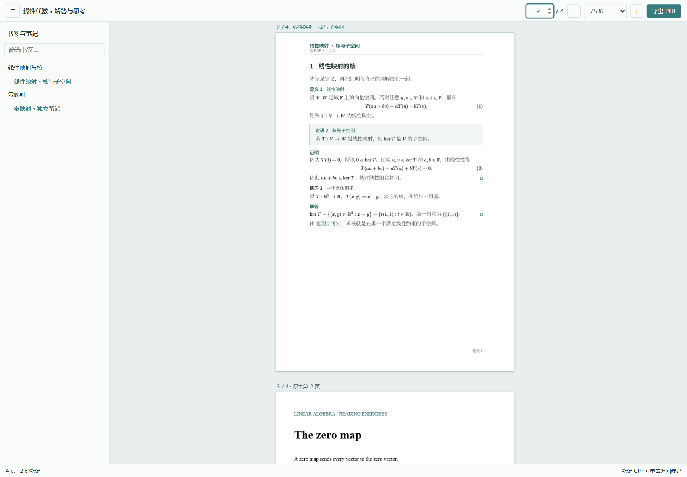

# Typst PDF Notebook

[在 VS Code 扩展市场安装](https://marketplace.visualstudio.com/items?itemName=ArcBC.typst-pdf-notebook)

在 VS Code 中阅读 PDF，用 Typst 记录笔记，并将笔记插在相关原书页之后，导出为一本完整的 PDF。支持页内右侧便签、数学排版、书签跳转和笔记源码双向定位。

Read a PDF alongside Typst notes, then export one PDF with notes inserted after the relevant pages.



## 开始使用

需要 **VS Code 1.97.0 或更新版本**，以及 **Tinymist 0.15.10 或更新版本**。支持 Windows、macOS 和 Linux。

1. 在扩展市场安装 [Typst PDF Notebook](https://marketplace.visualstudio.com/items?itemName=ArcBC.typst-pdf-notebook)（发布者 **ArcBC**），依赖的 Tinymist 会随之安装。也可从 [GitHub Releases](https://github.com/ArchiBC/typst-pdf-notebook/releases) 下载 VSIX，通过 **Extensions: Install from VSIX** 安装。
2. 用 VS Code 打开存放 PDF 的文件夹，并信任该工作区。
3. 在资源管理器中右键 PDF → **新建 Typst 笔记**，插件会在旁边创建 `原书名.notes.typ`，填写原书路径和页面尺寸。右键文件夹也可选择其中的 PDF；已有同名笔记时直接打开。
4. 点击 Typst 编辑器右上角的书本按钮，或执行 **PDF Notebook: 打开整本笔记预览**。

在生成的文件中，使用 `#note(...)` 指定笔记插入位置，随后直接写正文：

```typst
#import "@local/typst-pdf-notebook:0.3.3": *
#show: notebook.with(pdf: "book.pdf")

#note(1)

= 我的理解

这份笔记放在原书第 1 页之后。

$a + b = b + a$

#note("习题1A")
#include "notes/answers-1a.typ"
```

`#note(...)` 后的内容一直属于该笔记，直到下一处标记或文件结尾。也支持 `#note(28)[正文]`。内容自动分页，空笔记跳过。

数字使用原 PDF 的物理页码，从 1 开始，包含封面。字符串可使用 PDF 书签完整标题或 `pdf-001` 这样的唯一 ID；标题重复时使用 ID。拆分到其他文件的正文通过 `#include` 引入，在其中调用数学环境等函数时，需在该文件中导入相应函数。

## 页内右侧便签

使用 `#sidenote(...)` 或 `#note(..., right)`，将笔记排在原页右侧。预览和导出会得到一张加宽页面，总页数保持不变。

```typst
#sidenote(15)

= 这一页的理解

默认便签宽度为主页的三分之一。

#note("习题1A", right)
#include "notes/answers-1a.typ"

#sidenote(28, width: 50%)

这份便签使用主页一半的宽度。

#note(30)

这份笔记放在第 30 页后的普通附页中。
```

`width` 支持百分比、比例（如 `1/2`）或长度（如 `60mm`）。可通过 `notebook.with(side-width: 50%, side-margin: 6mm)` 统一设置宽度和内部页边距，也可在单份便签中设置 `margin`。便签高度沿用主页高度，原书页保持原始大小。

便签超过一页时，整份笔记自动排成普通附页；缩短至一页后恢复右侧显示。同一原页有多份便签，或原页高度不足以容纳便签时，也采用普通附页。同一页的便签内容集中写在一处标记中即可。完整示例见 [side.notes.typ](examples/side.notes.typ)。

## 数学笔记

内置 [Chengsi（澄思）](https://typst.app/universe/package/chengsi/) 数学笔记样式。使用 `*` 导入后，可直接调用 `definition`、`theorem`、`lemma`、`proposition`、`corollary`、`example`、`exercise`、`proof`、`remark`、`epigraph` 和 `code`。

```typst
#note(28)

= 核与子空间

#theorem(title: [核是子空间])[
  若 $T: V -> W$ 是线性映射，则 $ker T$ 是 $V$ 的子空间。
] <kernel>

#proof[
  由线性性，核包含零向量，并且对线性组合封闭。
]

由 @kernel 可知，求核就是求一个满足线性约束的子空间。
```

每份笔记独立编号，同一笔记跨页时继续编号。定义、定理、引理、命题、推论和练习共用一个编号序列，例题单独编号。标题、公式、图、表和脚注也在新笔记中重新计数。

支持原生标签、跨笔记引用和长定理跨页；标签名称需在整个文档中唯一。完整示例见 [chengsi.notes.typ](examples/chengsi.notes.typ)。

## 排版与配置

在笔记开头的 `notebook.with(...)` 中配置纸张、配色和数学编号：

```typst
#show: notebook.with(
  pdf: "book.pdf",
  title: "阅读笔记",
  size: (176mm, 250mm),
  config: (
    theme: "indigo", // teal / indigo / sepia
    font-size: 11pt,
    margin: 15mm,
    heading-numbering: none,
    equation-numbering: "(1)",
    theorem-numbering: "1",
  ),
  bookmarks: (
    (page: 28, title: "重做这页", id: "redo", depth: 0),
  ),
  note-settings: (
    "28": (title: "定义与例子", style: "grid"),
  ),
)
```

纸张样式支持 `blank`、`ruled` 和 `grid`。`note-settings` 按笔记位置设置标题、样式和 ID，单份笔记中的显式选项优先。自定义书签可通过 `#note("redo")` 引用；`#source-ref(28)[返回原题]` 可创建指向原书页的链接。

Chengsi 的 `font-cjk`、`font-heading`、`font-math`、`leading`、`paragraph-spacing`、`headers` 和 `page-numbers` 等选项可放在 `config` 中。插页模式采用紧凑节标题，封面、目录和章分页由原书承担。默认中文字体为 Noto Serif SC / Noto Sans SC，公式字体为 New Computer Modern Math，也可配置为本机已有字体。

模板随插件提供，以标准 Typst 本地包安装。新笔记使用 `@local/typst-pdf-notebook:0.3.3`；已有笔记可点击编辑器右上角的 **升级笔记模板** 按钮更新导入，正文和未保存的编辑会保留，并支持撤销。旧模板也随插件保留。

预览中的编译错误会显示详情，修正源码后自动恢复。旧模板遇到新版便签语法时，可点击预览中的 **升级模板并重试**，更新该笔记的模板导入并保留未保存正文。

插件沿用 Tinymist 的引擎、字体和包目录配置。VS Code 中的两个可选设置为：

| 设置                       | 默认值     | 作用                                               |
| -------------------------- | ---------- | -------------------------------------------------- |
| `pdfNotebook.followCursor` | `true`     | 移动源码光标时定位预览                             |
| `pdfNotebook.entry`        | `main.typ` | 自动识别不到当前或最近使用的笔记时，使用的备用入口 |

## 阅读、定位与导出

- 原书文字可选择、复制，书签和原书内部页链接可跳转。
- 在预览页面按住 **Ctrl** 并滚动鼠标滚轮，可以围绕鼠标位置缩放页面。
- 移动笔记源码光标可定位预览，也可按 **Ctrl+Alt+J**（macOS 为 **Cmd+Alt+J**）主动定位。
- 在预览的笔记正文上 **Ctrl+单击**，返回对应源码文件和位置。
- 编辑正文时自动更新预览，包含尚未保存的内容；编译出错时保留最后一次成功的页面。
- 点击预览中的 **导出 PDF**，或执行 **PDF Notebook: 导出插页 PDF**，保存含原书和笔记的完整 PDF。

原书和笔记入口应位于当前工作区。导出支持文字、矢量、页内批注、书签和跳转；文档级表单字段树、附件和数字签名暂不支持迁移。直接用 Typst 编译笔记入口会得到笔记页，整本插页 PDF 通过插件导出。

问题反馈请使用 [GitHub Issues](https://github.com/ArchiBC/typst-pdf-notebook/issues)。构建、测试及发布说明见 [开发文档](docs/development.md)，版本变化见 [CHANGELOG](CHANGELOG.md)。
